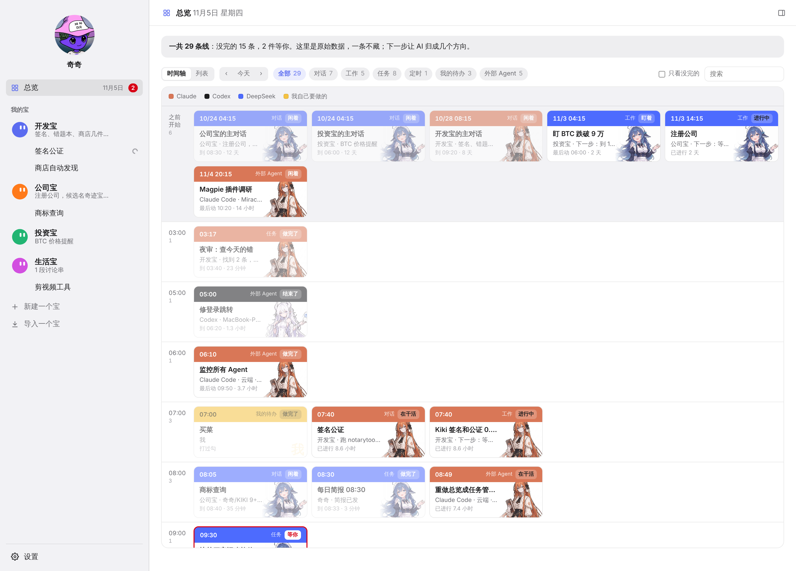
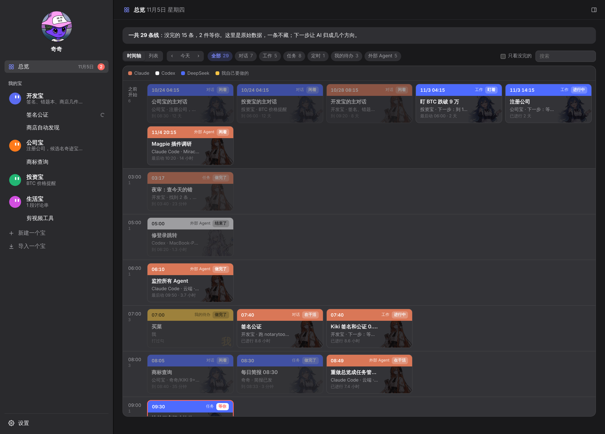

# Kiki 主题：AI 娘

Kiki 的非官方外部主题。把总览时间轴卡片的右侧换成 AI 娘半身立绘：Claude 干的活配 Claude 娘，DeepSeek 配 DeepSeek 娘，Codex/OpenAI 配 GPT 娘。立绘只占卡片右边 40%，不挡文字。

| 浅色 | 深色 |
|---|---|
|  |  |

## 安装

在跑 Kiki 的电脑上：

```sh
git clone <本仓库地址> kiki-theme-ai-girls
sh kiki-theme-ai-girls/install.sh
```

然后打开 Kiki › 设置 › 外观，选「AI 娘（浅色）」或「AI 娘（深色）」。卸载就删掉 `~/kiki-data/themes/ai-girls*`。

## 素材署名

立绘整理自 [shuaizenge/ai-girls](https://github.com/shuaizenge/ai-girls)，本仓库保存了缩小到 1400 像素高的副本，没有改动画面。

- **Claude、GPT**：作者 [ZipZipPipe](https://www.pixiv.net/users/18604994)（[Bilibili](https://space.bilibili.com/4168597)），出自《AI娘化》（[Pixiv 148186519](https://www.pixiv.net/artworks/148186519)）。作者在 [这里](https://www.bilibili.com/video/BV1bARXBYEZz/) 说明图片开放分享、允许再创作。
- **DeepSeek**：原角色（鲸鱼娘）[上善无形](https://space.bilibili.com/4456176)；DeepSeek 女仆二次设计 ZipZipPipe，作者声明 **CC BY-NC-SA 4.0**（[来源](https://www.bilibili.com/video/BV1tE9XBbErS/)）。

## 许可

本主题包（样式、截图和图片副本）按 [CC BY-NC-SA 4.0](https://creativecommons.org/licenses/by-nc-sa/4.0/deed.zh-hans) 提供：转载请保留上面的署名，**不得商用**，改编后按相同许可发布。

DeepSeek、ChatGPT/GPT、Claude、Codex 等名称和商标归各自权利人所有。这些是社区拟人设计，和厂商、和 Kiki 官方都没有关系。如果你是作者并希望调整署名或移除素材，请开 Issue。
